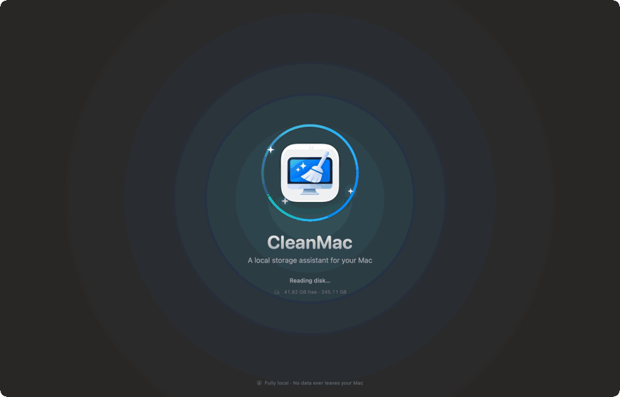
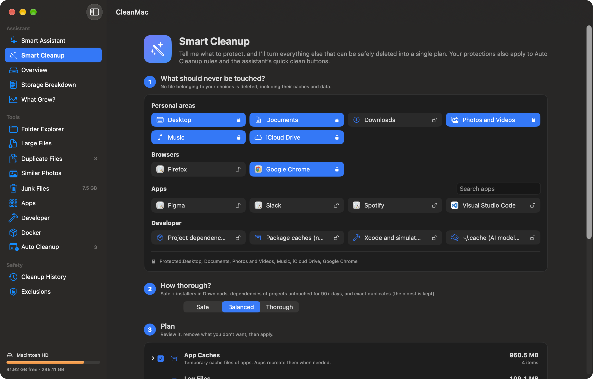
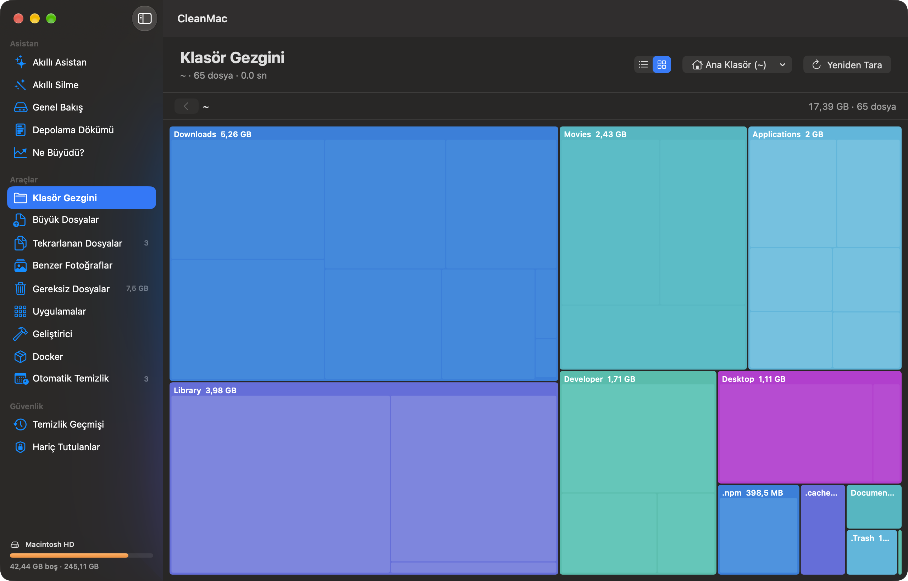
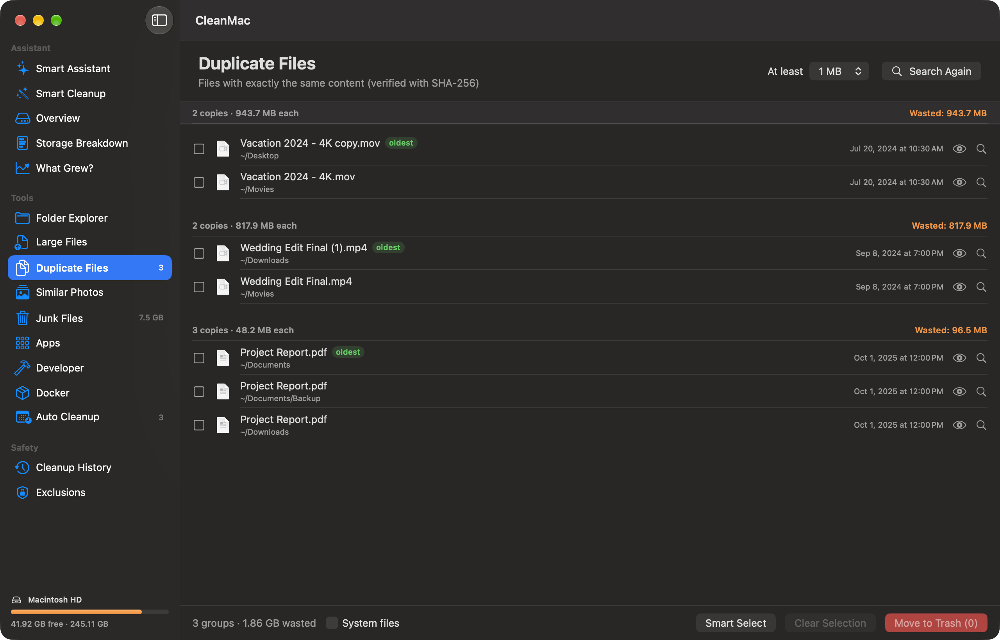
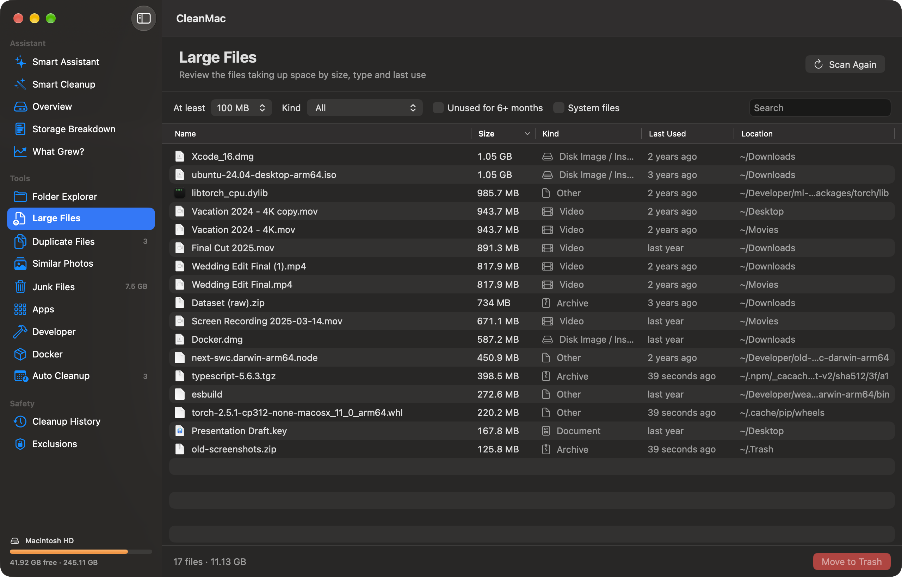
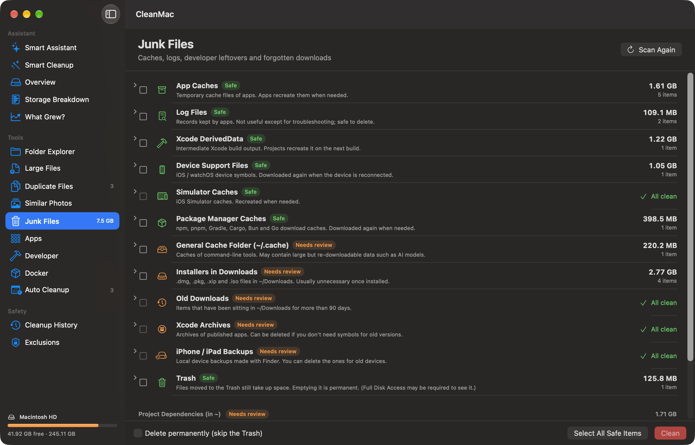
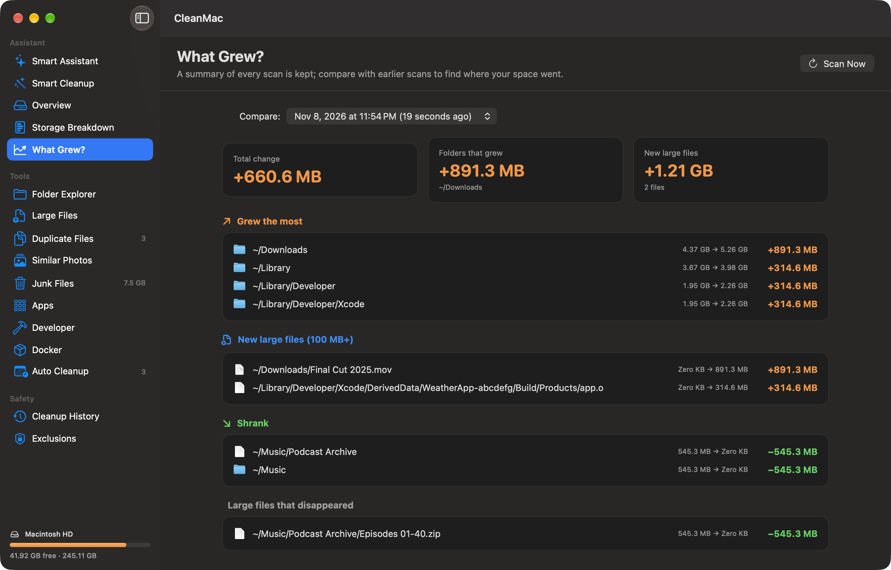
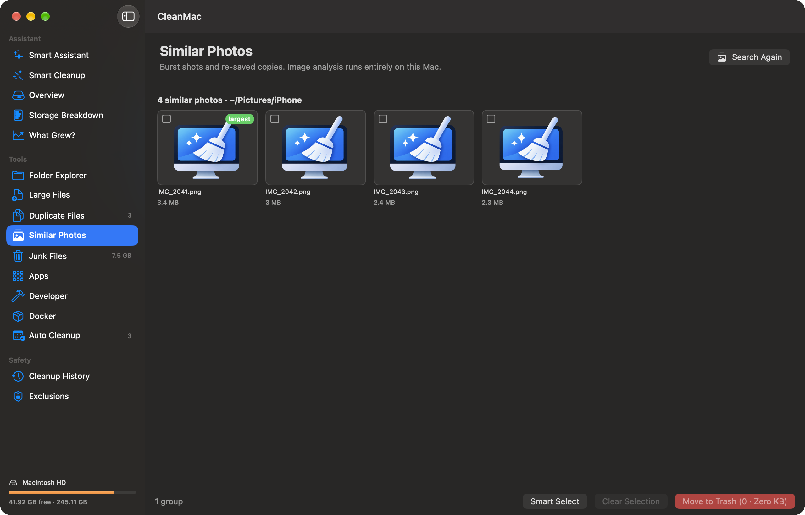
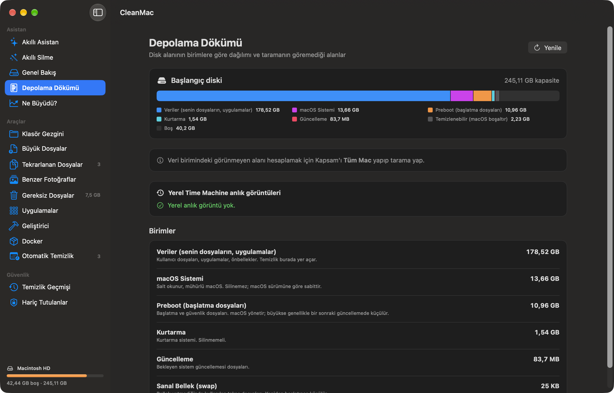

<p align="center">
  
</p>

<h1 align="center">CleanMac</h1>

<p align="center">
  An open-source, <b>fully local</b> storage assistant for macOS that shows what is filling up<br>
  your disk, explains it, and helps you clean up safely.
</p>

<p align="center">
  <a href="https://github.com/kadirmertabatay/clean-mac/actions/workflows/ci.yml"></a>
  <a href="https://github.com/kadirmertabatay/clean-mac/releases/latest"></a>
  <a href="https://github.com/kadirmertabatay/clean-mac/releases"></a>
  <a href="LICENSE"></a>
  
  
  
  
  
</p>

<p align="center">
  <a href="https://github.com/kadirmertabatay/clean-mac/releases/latest/download/CleanMac.dmg"></a>
  <br>
  <sub>Free · macOS 14 or later · Apple silicon and Intel · <a href="https://github.com/kadirmertabatay/clean-mac/releases">All releases</a></sub>
</p>

<p align="center">
  <a href="#installation">Installation</a> ·
  <a href="#features">Features</a> ·
  <a href="#safety-principles">Safety</a> ·
  <a href="docs/README.md">Documentation</a> ·
  <a href="CONTRIBUTING.md">Contributing</a>
</p>

<p align="center">
  
</p>

---

## Why CleanMac?

- **Privacy first.** The app makes no network requests: no analytics, no accounts, no cloud. Every scan and comparison runs on your Mac.
- **Explains before it deletes.** Every suggestion says what is using space, why, how much, and what happens if you remove it.
- **Reversible.** By default everything goes to the Trash and can be put back from Cleanup History with one click.
- **You stay in control.** In Smart Cleanup you choose the apps and folders that must never be touched (e.g. "don't touch Chrome"), and those protections apply to every automated flow.
- **Lightweight and native.** Pure SwiftUI, no third-party dependencies, and a parallel scanner that uses every core.
- **English and Turkish.** Switch the interface language in Settings.

## Features

<table>
  <tr>
    <td width="50%" valign="top">
      
      <p><b>Smart Cleanup.</b> First choose what must never be touched (Desktop, Chrome, project dependencies…), then get a single Safe / Balanced / Thorough plan. Items skipped because of a protection are listed separately.</p>
    </td>
    <td width="50%" valign="top">
      
      <p><b>Folder Explorer.</b> Browse the size tree as a list with a donut chart, or as a treemap. Double-click to drill down; right-click to show in Finder or move to the Trash.</p>
    </td>
  </tr>
  <tr>
    <td valign="top">
      
      <p><b>Duplicate Files.</b> Finds byte-identical files with size → head/tail digest → full SHA-256. Smart Select keeps the oldest copy, and selecting every copy in a group is blocked.</p>
    </td>
    <td valign="top">
      
      <p><b>Large Files.</b> Sort by size, kind, last use and location. Includes an "unused for 6+ months" filter and verified archiving to an external disk.</p>
    </td>
  </tr>
  <tr>
    <td valign="top">
      
      <p><b>Junk Files.</b> Caches, logs, Xcode data, package manager caches, installers, old downloads, iPhone backups and the Trash. Every category is labeled with a safety level.</p>
    </td>
    <td valign="top">
      
      <p><b>What Grew?</b> A summary of every scan is kept. Shows folders that grew or shrank and large files that appeared or disappeared since an earlier scan.</p>
    </td>
  </tr>
  <tr>
    <td valign="top">
      
      <p><b>Similar Photos.</b> Groups burst shots and re-saved copies using Apple Vision image feature prints, entirely on device.</p>
    </td>
    <td valign="top">
      
      <p><b>Storage Breakdown.</b> APFS volumes, space macOS can purge on its own, local Time Machine snapshots, and the space the scan can't see.</p>
    </td>
  </tr>
</table>

And also:

| | |
|---|---|
| **Smart Assistant** | Runs a full analysis with one click and lists suggestions by priority. |
| **Apps** | Uninstalls apps together with the files they left in `~/Library`, and shows apps you haven't opened in a long time. |
| **Developer** | Homebrew cleanup, unused Xcode simulators, and `node_modules` / `.venv` folders of untouched projects. |
| **Docker** | Appears when Docker is installed. Lists images, containers, volumes and the build cache. Finds untagged, outdated, unused and redundant tags, and shrinks the virtual disk. |
| **Auto Cleanup** | Scheduled rules (e.g. clean app caches weekly). By default a rule prepares a preview and a notification first and needs your approval. |
| **Menu bar** | Shows free space in the menu bar and notifies you when it drops below your threshold. |
| **History and Exclusions** | A record of every removed item with restore. Excluded items are never suggested and never deleted. |

Every screen is described in detail in **[docs/features.md](docs/features.md)**.

## How it compares

| | CleanMac | [DaisyDisk](https://daisydiskapp.com/) | [GrandPerspective](https://grandperspectiv.sourceforge.net/) | [OmniDiskSweeper](https://www.omnigroup.com/more) | [CleanMyMac](https://macpaw.com/cleanmymac) |
|---|:---:|:---:|:---:|:---:|:---:|
| Price | Free | $9.99 one-time | Free ($2.99 on the App Store) | Free | Subscription (from $3.33/month) |
| Open source | ✅ MIT | — | ✅ GPL | — | — |
| Visual disk map | ✅ Treemap and donut chart | ✅ | ✅ Treemap | Sorted list | — |
| Duplicate files | ✅ SHA-256 | — | — | — | ✅ |
| Similar photos | ✅ On device | — | — | — | ✅ |
| App uninstaller with leftovers | ✅ | — | — | — | ✅ |
| Developer cleanup (Xcode, Docker, `node_modules`) | ✅ | — | — | — | — |
| "Never touch this" protections per app | ✅ | — | — | — | — |
| Growth history between scans | ✅ | — | — | — | — |

<sub>Based on each vendor's public product page (November 2026); "—" means the feature isn't listed there. Spotted a mistake? Please [open an issue](https://github.com/kadirmertabatay/clean-mac/issues/new/choose).</sub>

## Installation

### Download (recommended)

1. **[Download CleanMac.dmg](https://github.com/kadirmertabatay/clean-mac/releases/latest/download/CleanMac.dmg)**: always the latest version.
2. Open the DMG and drag **CleanMac** onto the **Applications** folder.
3. Open CleanMac from Applications. The app is ad-hoc signed, not signed with an Apple Developer ID, so macOS warns you the first time:
   - **macOS 14:** right-click the app › **Open** › **Open**.
   - **macOS 15 and later:** try to open it once, then go to **System Settings › Privacy & Security** and click **Open Anyway**.

This is only needed on the first launch. Releases are universal binaries for Apple silicon and Intel Macs. A zip of the same app and a `SHA256SUMS.txt` file are attached to every [release](https://github.com/kadirmertabatay/clean-mac/releases); verify the download with `shasum -a 256 CleanMac.dmg`.

### Build from source

Requirements: macOS 14 Sonoma or later, and Xcode 15+ (or the Xcode Command Line Tools with Swift 5.9+).

```bash
git clone https://github.com/kadirmertabatay/clean-mac.git
cd clean-mac
./build-app.sh            # build/CleanMac.app
open build/CleanMac.app

./build-app.sh --install  # also copies it to /Applications
```

Use `swift run` while developing and `swift test` to run the tests. See [docs/development.md](docs/development.md) for details.

## Usage

1. On the **Smart Assistant** screen, pick a **Scope**: *Home Folder (~)*, *Entire Mac (/)* or *Other Folder…*
2. Click **Start Full Analysis**. Junk files, folder sizes, duplicates, the storage breakdown and apps are computed in one pass.
3. Review the suggestions. Each row's button takes you to the relevant screen or, for "safe" categories only, cleans right away.
4. For a single cleanup plan, open **Smart Cleanup**, choose your protections and approve the plan.

To permanently protect a folder, right-click it in any list › **Exclude**.

To change the interface language, open **Settings (⌘,) › Language** and choose **English**, **Türkçe** or **System Default**, then restart the app.

## Safety principles

CleanMac deletes files, so safety is at the center of its design:

- **No deletion without confirmation.** Every action shows a summary and a confirmation dialog first.
- **Trash by default.** Permanent deletion only happens when you explicitly choose it (and when emptying the Trash).
- **Re-checked at the last moment.** Right before removal, every item is checked again. If it changed after the scan, no longer exists or has been excluded, it is skipped.
- **Duplicates always keep a copy.** At removal time CleanMac verifies that the copy being kept still exists. Hard links are not counted as copies.
- **Protected locations.** System folders and the contents of app bundles (`.app`, `.photoslibrary` …) are hidden from the large-file and duplicate lists by default.
- **iCloud is left alone.** Cloud-only (not downloaded) files are never read, so no downloads are triggered.
- **Honest status.** Locations that can't be read are shown as "No access", never as "All clean".

See [docs/safety.md](docs/safety.md) for the design in detail. If you find a security issue, please follow [SECURITY.md](SECURITY.md).

## Permissions

| Permission | Why | Required? |
|---|---|---|
| Desktop / Documents / Downloads | To measure the size of these folders | macOS asks during the first scan |
| Full Disk Access | To see protected locations such as the Trash, Mail and iPhone backups | Optional; the assistant reminds you if it's missing |
| Notifications | To tell you when free space is low or an Auto Cleanup rule awaits approval | Optional |
| Administrator password | Only when deleting local Time Machine snapshots | Asked at that moment |

To grant Full Disk Access, add CleanMac under **System Settings › Privacy & Security › Full Disk Access**.

## Documentation

| Document | Contents |
|---|---|
| [Features](docs/features.md) | Every screen in detail, with screenshots |
| [Safety and Privacy](docs/safety.md) | The removal flow, checks, protections and stored data |
| [Architecture](docs/architecture.md) | Code layout, scanner design, concurrency model, localization |
| [Development](docs/development.md) | Building, testing, environment variables, screenshots, translations, releasing |
| [FAQ and Troubleshooting](docs/faq.md) | Common questions, permission issues, launch warnings |

## Roadmap

- [ ] Developer ID signing and notarization, so releases open without a Gatekeeper warning
- [ ] Homebrew Cask (`brew install --cask cleanmac`)
- [ ] More languages (translations are welcome, see [Translations](docs/development.md#translations))
- [ ] More junk categories: Mail and Messages attachments, old iOS updates, browser caches per profile
- [ ] Export a scan report (CSV / Markdown)
- [ ] Optional scheduled background scans

Have an idea? Open a [feature request](https://github.com/kadirmertabatay/clean-mac/issues/new/choose) or start a [discussion](https://github.com/kadirmertabatay/clean-mac/discussions).

## Contributing

Bug reports, ideas, translations and pull requests are welcome. Please read [CONTRIBUTING.md](CONTRIBUTING.md) and the [Code of Conduct](CODE_OF_CONDUCT.md) before you start. New pull requests target the `develop` branch; see the [branching model](CONTRIBUTING.md#branching-model). Release notes are in [CHANGELOG.md](CHANGELOG.md).

Issues labeled [good first issue](https://github.com/kadirmertabatay/clean-mac/labels/good%20first%20issue) are a good place to start. For questions, see [SUPPORT.md](SUPPORT.md).

## Support the project

If CleanMac helped you free up space, consider giving the repository a ⭐. It helps other Mac users find it.

## License

CleanMac is released under the [MIT License](LICENSE). © 2026 Kadir Mert Abatay
