# Features

CleanMac's sidebar has three sections: **Assistant** (what should I do?), **Tools** (dig into the details) and **Safety** (undo and protect). This page walks through every screen.

> The screenshots are generated from a fake demo home folder with `scripts/screenshots.sh`.

- [Welcome screen](#welcome-screen)
- Assistant: [Smart Assistant](#smart-assistant) · [Smart Cleanup](#smart-cleanup) · [Overview](#overview) · [Storage Breakdown](#storage-breakdown) · [What Grew?](#what-grew)
- Tools: [Folder Explorer](#folder-explorer) · [Large Files](#large-files) · [Duplicate Files](#duplicate-files) · [Similar Photos](#similar-photos) · [Junk Files](#junk-files) · [Apps](#apps) · [Developer](#developer) · [Docker](#docker) · [Auto Cleanup](#auto-cleanup)
- Safety: [Cleanup History](#cleanup-history) · [Exclusions](#exclusions)
- [Menu bar and Settings](#menu-bar-and-settings) · [Language](#language) · [Scan scope](#scan-scope) · [Keyboard shortcuts](#keyboard-shortcuts)

---

## Welcome screen

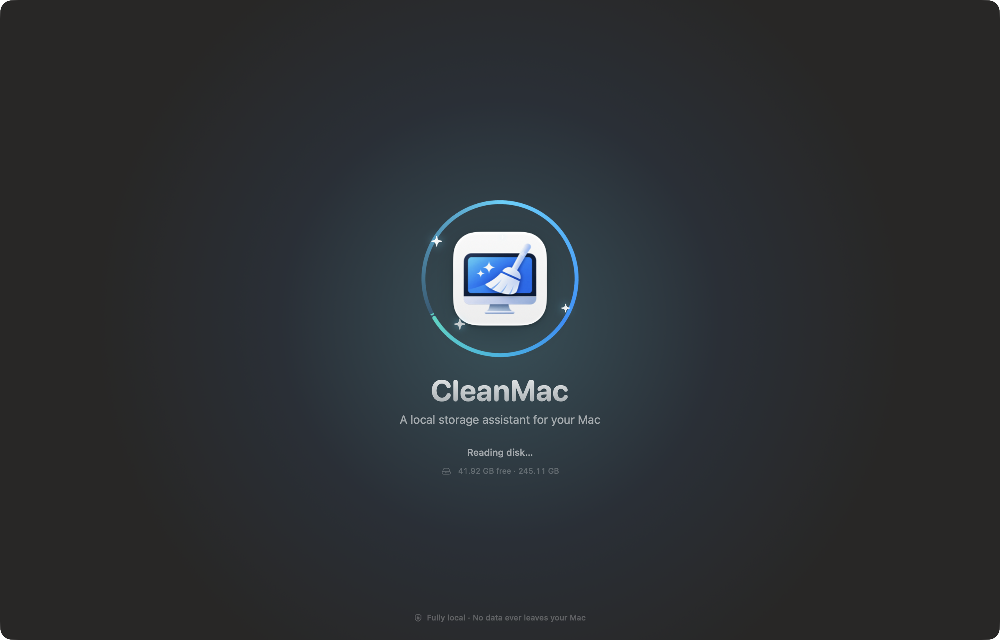

Shown once at launch: the logo, a scan ring and the current free space on your disk. Click to dismiss it right away. You can turn it off in **Settings › Appearance**. If "Reduce motion" is on in macOS, it is shown without animation.

## Smart Assistant

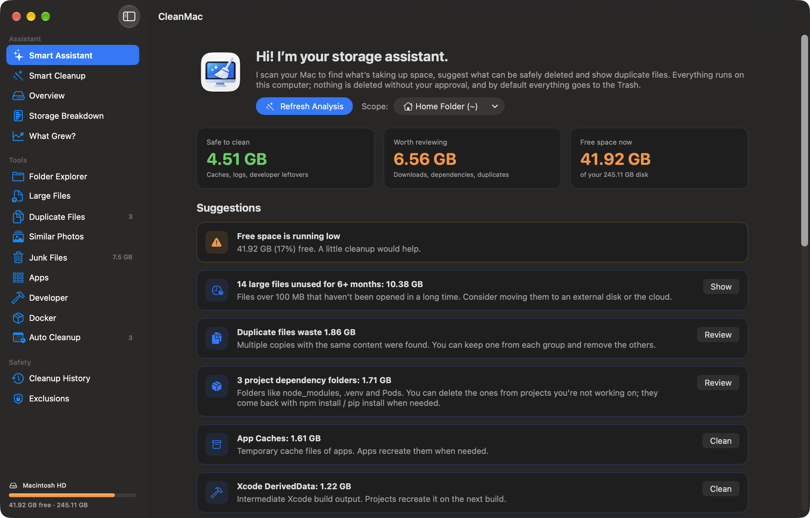

The start screen. **Start Full Analysis** does the following, in order:

1. scans the junk file categories,
2. builds the folder tree for the selected scope,
3. compares duplicate files,
4. computes the storage breakdown and the app list.

The three cards at the top show space that is **safe to clean** (caches, logs, developer leftovers), space **worth reviewing** (downloads, dependencies, duplicates) and the current free space.

Suggestions are listed by priority: low disk space warnings, large files unused for a long time, duplicates, project dependencies, caches… Each suggestion has either a button that takes you to the relevant screen or, for categories labeled "safe" only, a **Clean** button. Space the scan can't see (folders without permission, Time Machine snapshots, space macOS can purge) is explained separately.

## Smart Cleanup

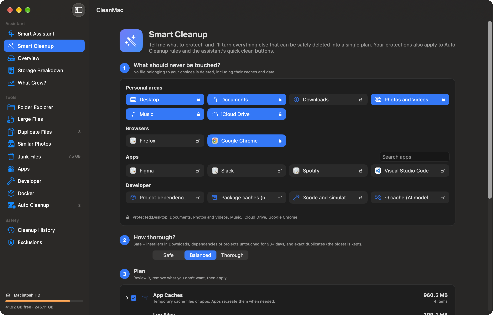

Builds a single cleanup plan in three steps.

**1. What should never be touched?** Click the chips to lock them:

| Group | Examples | Default |
|---|---|---|
| Personal areas | Desktop, Documents, Photos and Videos, Music, iCloud Drive, Downloads | Everything except Downloads is protected |
| Browsers | Chrome, Safari, Firefox, Brave, Arc, Edge… (the installed ones) | Not protected |
| Apps | Every installed app, searchable | Not protected |
| Developer | Project dependencies, package caches, Xcode and simulators, `~/.cache` | Not protected |

When an app is protected, its caches and data are matched by bundle identifier, known folder names and vendor folders. For Chrome, for example, `~/Library/Caches/Google/Chrome` is protected. Folders that **contain** something protected are protected too, so a protection can't be bypassed by deleting a parent folder.

**2. How thorough?**

| Level | What goes into the plan |
|---|---|
| **Safe** | App caches, logs, Xcode DerivedData, device support files, simulator and package manager caches |
| **Balanced** | Safe + installers in Downloads + dependencies of projects untouched for more than 90 days + exact duplicates (the oldest in each group is kept) |
| **Thorough** | Balanced + old downloads + `~/.cache` + dependencies of projects untouched for more than 30 days |

**3. Plan.** The plan is previewed in groups. Uncheck anything you don't want, or right-click it › **Exclude**. The "Skipped because protected" section shows how many items and how much space each protection saved. Once you approve, everything is moved to the Trash. Regenerable caches are deleted permanently only if "Delete junk files permanently" is on in Settings.

Protections also apply to **Auto Cleanup** rules and to the assistant's quick **Clean** buttons.

## Overview

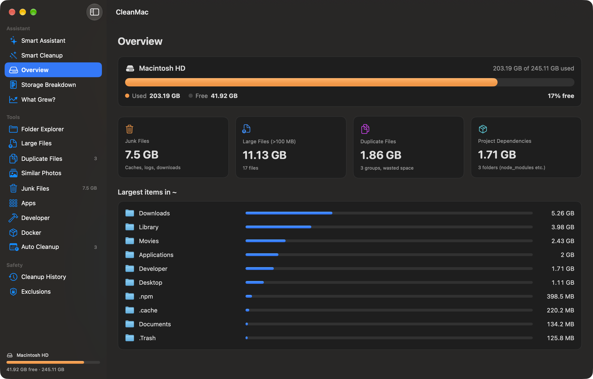

Disk usage, four summary cards (junk files, large files, duplicates, project dependencies) and the largest items in the scanned folder.

## Storage Breakdown

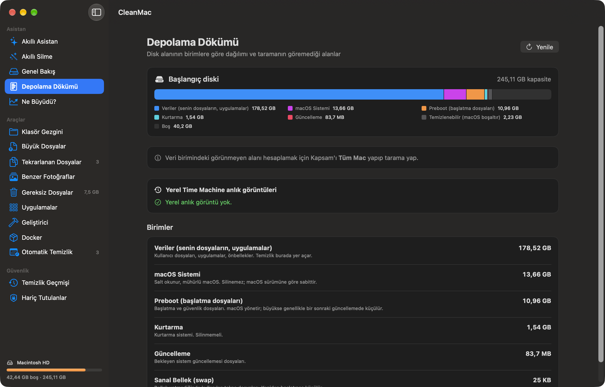

Splits the startup disk by APFS volume: Data, macOS System, Preboot, Recovery, Update and Virtual Memory. It shows **purgeable** space that macOS can free on its own when needed, and local **Time Machine snapshots**. Snapshots can be deleted here; this asks for an administrator password. When the scope is *Entire Mac*, the space the scan couldn't see is calculated too.

## What Grew?

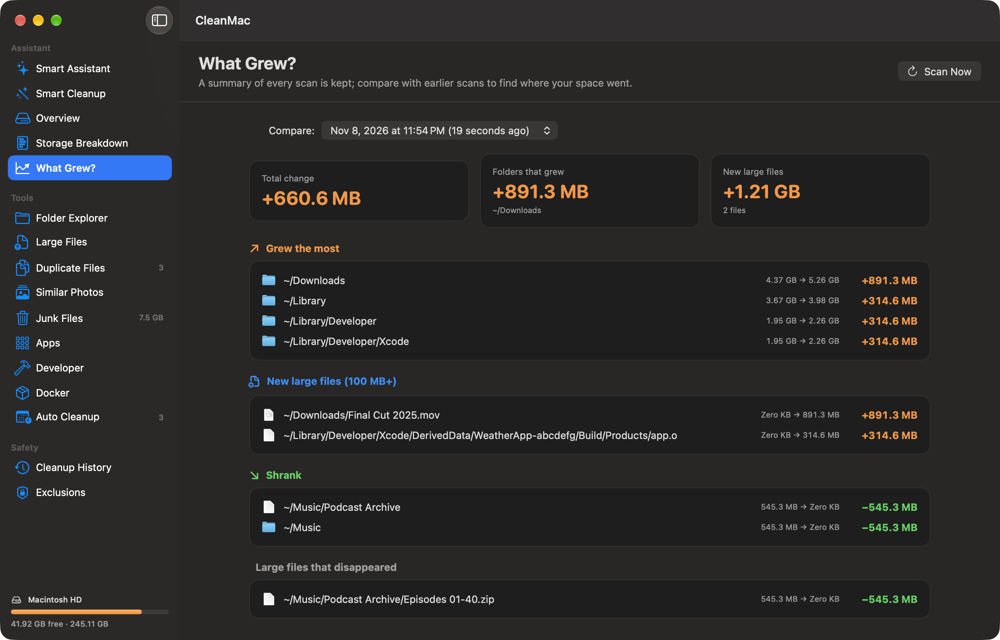

When a scan finishes, a summary of the folder tree is saved (the last 12 scans per scope). This screen compares the current scan with an earlier one you pick:

- the total change,
- the folders that grew or shrank the most (over 10 MB, up to 3 levels deep),
- new and vanished large files (over 100 MB).

## Folder Explorer

| List and donut chart | Treemap |
|---|---|
| 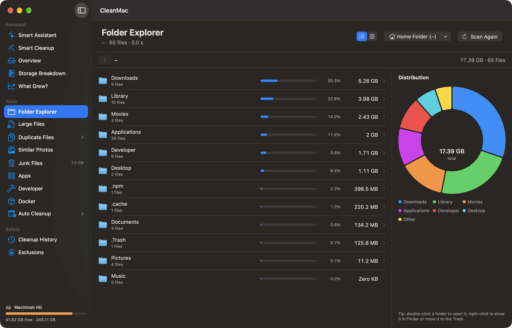 | 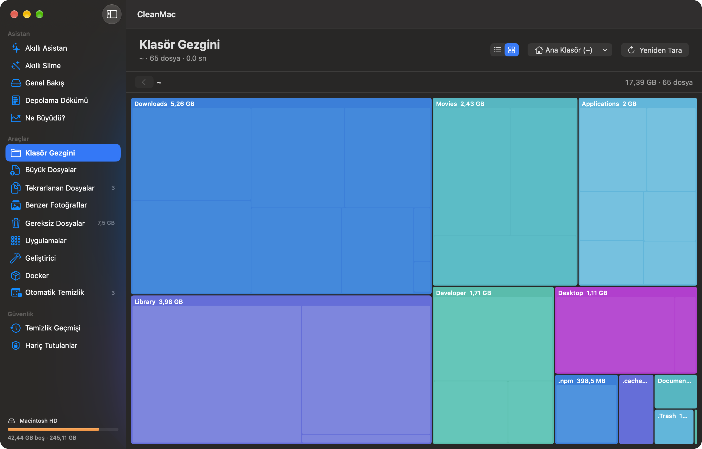 |

The size tree of the selected folder. Double-click to open a folder and use the path bar to go back. The context menu has **Show in Finder**, **Quick Look**, **Copy Path**, **Exclude** and **Move to Trash…**. The buttons at the top right switch between the list and treemap views.

## Large Files

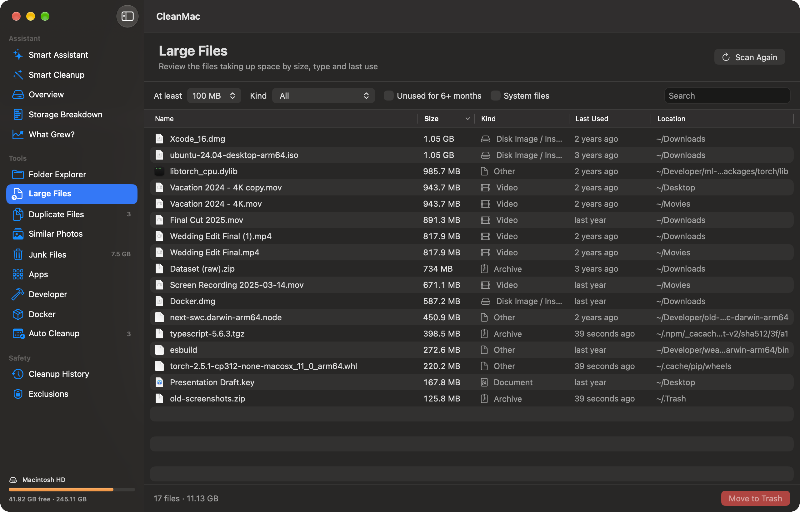

A table of the large files found by the scan. Sort by name, size, kind, last use and location.

- Filters: minimum size, kind (video, audio, image, archive, disk image, document…), "Unused for 6+ months", search.
- **System files** also shows files in protected locations (hidden by default).
- Press Space to preview a file with **Quick Look**.
- Right-click › **Archive to External Disk…**: the files are copied to the chosen disk, each copy is verified with SHA-256, and only then is the source moved to the Trash. The folder structure is kept under `CleanMac Archive/`.

## Duplicate Files

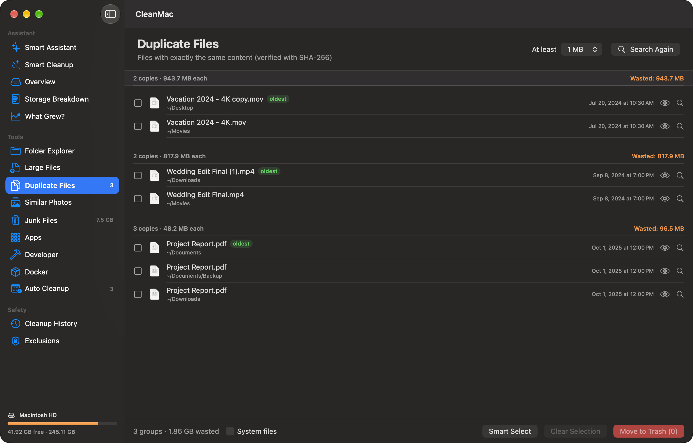

Finds byte-identical files in three stages: same size → digest of the first and last 64 KB → full SHA-256. Hard links (same inode) are not counted as copies. Cloud-only iCloud files are not read.

- **Smart Select** selects every copy in each group except the oldest.
- Selecting every copy in a group is blocked. At removal time CleanMac checks again that the kept copy is still on disk.
- Use **At least** to skip small files (1 MB by default).

## Similar Photos

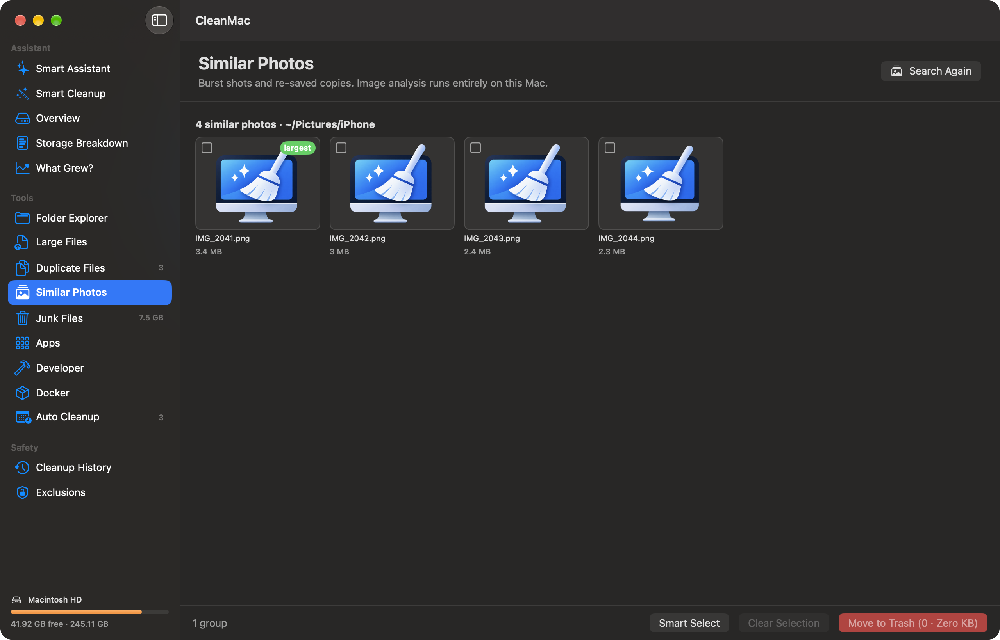

Finds burst shots and resized or re-saved copies. Apple Vision's image feature print (`VNGenerateImageFeaturePrintRequest`) is computed entirely on device, and photos that are close enough are grouped. JPEG, PNG, HEIC, TIFF, WebP and common RAW formats are supported. **Smart Select** keeps the largest (usually highest-quality) file in each group.

## Junk Files

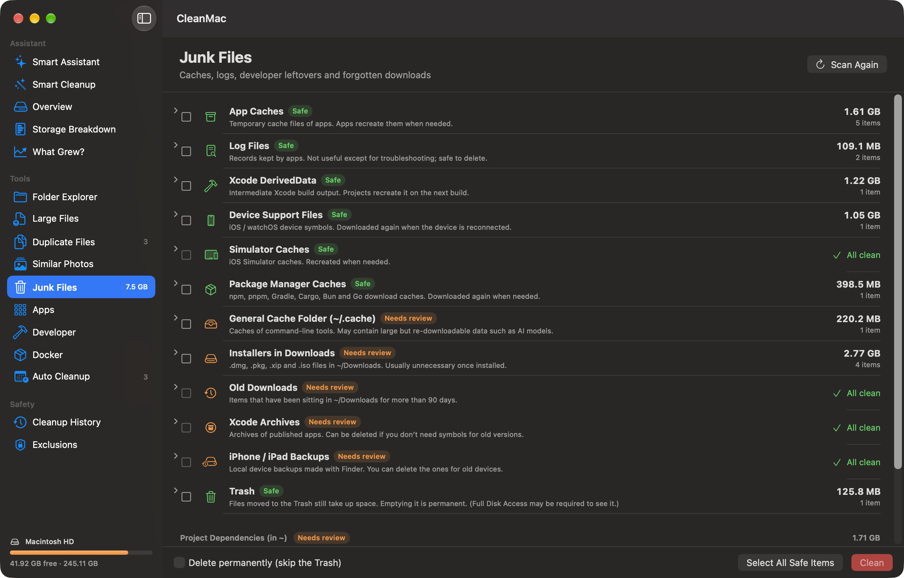

| Category | Label |
|---|---|
| App caches, logs | Safe |
| Xcode DerivedData, device support files, simulator caches | Safe |
| Package manager caches (npm, pnpm, Gradle, Cargo, Bun, Go…) | Safe |
| Trash | Safe (emptying is permanent) |
| `~/.cache` | Needs review |
| Installers in Downloads (`.dmg`, `.pkg`, `.xip`, `.iso`) | Needs review |
| Old downloads (not opened for more than 90 days) | Needs review |
| Xcode archives, iPhone / iPad backups | Needs review |
| Project dependencies (`node_modules`, `.venv`, `Pods`…) | Needs review |

"Safe" categories are data that apps recreate when needed. Expand any category to pick items one by one. **Delete permanently** skips the Trash.

## Apps

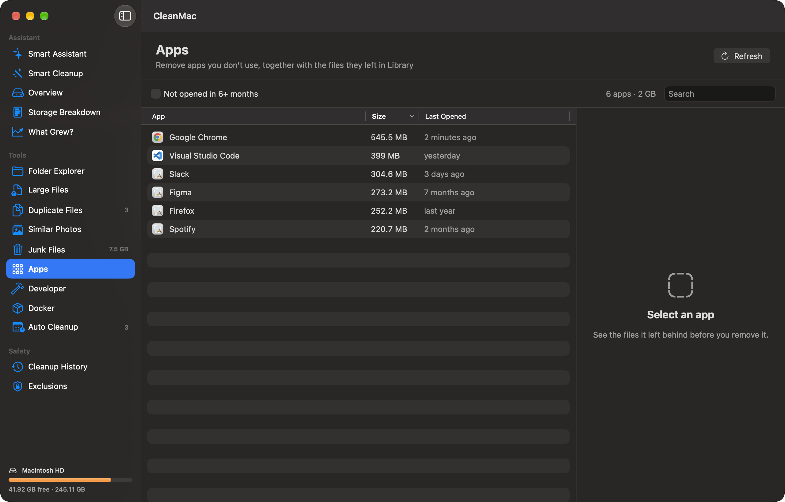

Lists the apps in `/Applications` and `~/Applications` with their size and last-opened date. **Not opened in 6+ months** finds forgotten apps. When you select an app, the files it left in `~/Library` (caches, preferences, Application Support, containers…) are matched by bundle identifier and shown. The app is moved to the Trash together with the leftovers you select. Apps that ship with macOS can't be removed.

## Developer

Uses developer tools' own cleanup commands and shows what will be deleted first:

- **Homebrew:** the output of `brew cleanup --dry-run`, and `brew cleanup` with one click.
- **Xcode simulators:** unused simulators for iOS versions that are no longer installed (`simctl delete unavailable`).
- **Untouched projects:** `node_modules` / `.venv` / `Pods` folders of projects not changed within the selected period.
- **Docker summary:** `docker system df` and `docker system prune`.

## Docker

Appears in the sidebar when Docker is installed. If Docker Desktop isn't running, you can start it with one click.

- **Images:** dangling (untagged) images, images no container uses, extra tags of the same image, and old versions of the same repository are flagged separately.
- **Containers:** stopped containers and their sizes.
- **Volumes:** volumes not attached to any container.
- **Build cache:** reclaimable space.
- **Shrink the virtual disk:** free blocks in Docker's virtual disk are returned to macOS with TRIM.

Deletions go through the Docker CLI. Images in use, running containers and attached volumes are never deleted.

## Auto Cleanup

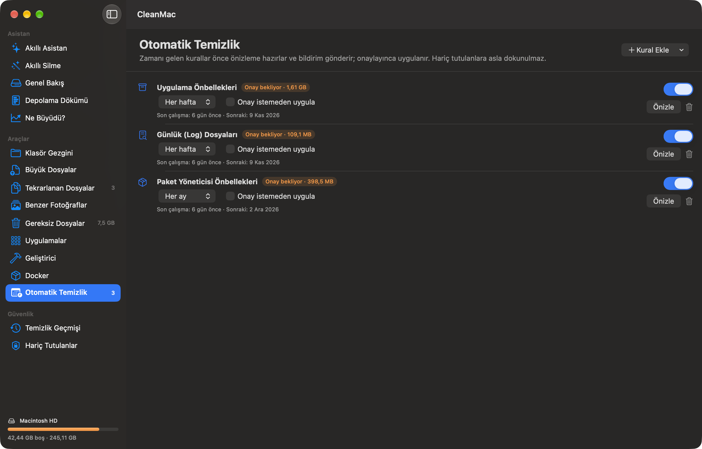

Scheduled rules such as "app caches every week", "package manager caches every month" or "installers older than 30 days". When a rule is due:

- by default it only prepares a **preview** and sends a notification; it needs your approval to run,
- if **Apply without asking** is on, it runs by itself.

Either way, exclusions and Smart Cleanup protections are respected. Rules are checked while the app is running (including when it is only in the menu bar).

## Cleanup History

A record of every item removed with CleanMac: the original path, size, date and location in the Trash. Items still in the Trash can be put back with **Restore**. If a file with the same name now exists at the original location, it is not overwritten.

## Exclusions

Folders and files added here never appear in any list, never go into any suggestion, and are skipped at the final check during removal. Add them with right-click › **Exclude** in any list, and remove them from this screen.

## Menu bar and Settings

The menu bar item shows free space. From its window you can start an analysis or open the main window. While the menu bar item is enabled, the app keeps running after the main window is closed.

**Settings (⌘,)**

| Setting | Default |
|---|---|
| Language | English |
| Show the welcome screen at launch | On |
| Show free space in the menu bar | On |
| Notify me when free space is low (threshold 5–25%) | On, 10% |
| Delete junk files permanently (skip the Trash) | Off |

Free space is checked every 5 minutes; at most one notification is sent per day.

## Language

The interface is available in **English** (default) and **Türkçe**. Choose one in **Settings › Language**, or pick **System Default** to follow the macOS language. The change takes effect after a restart; the **Restart Now** button relaunches the app. Translations live in a standard String Catalog; see [development.md](development.md#translations) to add or improve a language.

## Scan scope

Choose from the **Scope** menu on the Smart Assistant or Folder Explorer screen; your choice is remembered:

- **Home Folder (~):** only your user files. The fastest option.
- **Entire Mac (/):** the whole startup disk. External disks (`/Volumes`), `/System/Volumes` and virtual paths that show the disk a second time (`/.nofollow`, `/.resolve`, `/.vol`) are skipped.
- **Other Folder…:** any folder or external disk.

## Keyboard shortcuts

| Shortcut | Action |
|---|---|
| ⇧⌘R | Start full analysis |
| ⌘O | Choose folder and scan |
| ⌘. | Stop scan |
| ⌘, | Settings |
| Space | Preview the selected file with Quick Look (in lists) |
